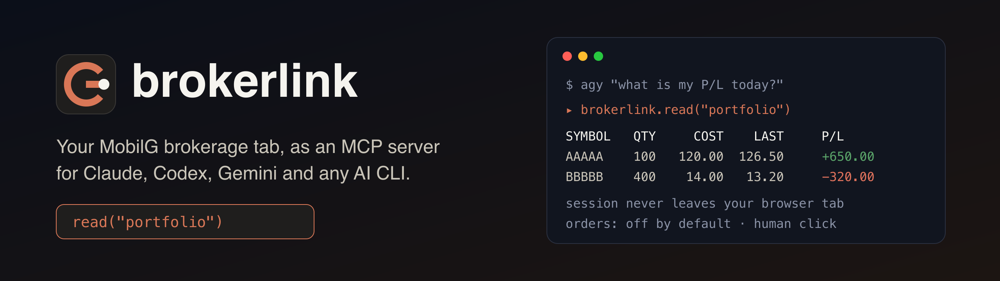

<p align="center">
  
</p>

<p align="center">
  
  
  
  
  <a href="AGENTS.md"></a>
  
</p>

<p align="center">
  <code>mcp</code> <code>chrome-extension</code> <code>bist</code> <code>borsa-istanbul</code> <code>phillipcapital</code> <code>mobilg</code> <code>claude</code> <code>codex</code> <code>gemini</code> <code>order-book</code>
</p>

brokerlink is a free, open-source Chrome extension and local MCP server that lets Claude, Codex, Gemini and other AI tools read your own PhillipCapital MobilG brokerage account through your logged-in browser tab.

**Unofficial.** Not affiliated with, endorsed by or supported by PhillipCapital. For your own account only, at your own risk. Not investment advice.

## How it works

```
AI client ──stdio MCP──▶ brokerlink.py mcp ──HTTP──▶ brokerlink.py serve (127.0.0.1:18890)
                                                         ▲ long-poll
                                 Chrome extension ──executeScript──▶ your logged-in MobilG tab
                                                                      fetch('/api/...') with the tab's own session
```

- **Nothing to configure after login.** Each call reads the session inside your MobilG tab at call time, so the bridge works as soon as you are logged in and stops when you log out. No token export, no sync button.
- **The session never leaves the tab.** The daemon, the MCP server and the AI never see your account number, password or session token.
- **It never opens or reloads MobilG.** A reload makes MobilG end the session, so brokerlink only uses the tab you already have open.
- **Double allowlist.** Every call is checked against [`extension/catalog.json`](extension/catalog.json) in the daemon and again in the extension.
- **Raw responses are kept locally** in `data/raw.sqlite` with session fields redacted.

## What you can ask for

| Area | Catalog names |
|---|---|
| Portfolio and cash | `portfolio`, `overall_history`, `bank_statement`, `stock_extract`, `stoppage` |
| Trades and orders (read) | `executed_transactions` (any date range), `transaction_result_form`, `order_tracking`, `synthetic_orders`, `synthetic_order_logs` |
| Market data | `price_info`, `depth` (order book), `last_trades` (tape), `akd` (broker distribution, needs licence), `metrics` (foreign stocks), `chart_history` (OHLCV), `stock_list` |
| News and research | `kap_for_symbol`, `kap_notifications`, `news`, `stock_reports`, `model_portfolio` |
| VIOP, funds, IPO, foreign, FX, T+0 | `viop_*`, `fund_*`, `public_offering*`, `foreign_*`, `fx_*`, `t0_*` (read only) |
| Safe writes | follow lists and price alarms |
| Orders | new, cancel, amend: queued for your click, see below |

The extension popup has four tabs: portfolio (positions, cost, last price, profit/loss), orders (approvals and settings), order history and release notes.

**Never included:** money-out and asset-transfer endpoints (EFT, transfers, FX conversion, collateral), login, password and settings, and the broker's AI-authorization switches. They are on a deny list.

## Orders

The popup is in Turkish (the broker's market): *Portföy* = portfolio, *Emirler* = orders, *Geçmiş* = history, *Yenilikler* = what's new, *Onayla / Reddet* = approve / reject, *Emirler açık* = orders enabled, *Onaysız gönderim* = send without approval.

On by default, with a switch in the extension popup ("Emirler açık") to turn them off. An order from an AI is only **queued**: nothing is sent until **you click Onayla (approve) in the popup**. The per-order and daily limits you set in the popup (defaults 2,500 TL and 10,000 TL) are checked first. An AI agent cannot approve and cannot flip the switches: they live in the browser.

### Auto-send ("Onaysız gönderim")

A separate card in the popup's **Emirler** tab, **off by default**. While it is on, limit orders, amendments and cancels below your limits are sent **without asking**; the reply to `place_order` is then MobilG's answer. Market orders and anything above the limits still wait for your click. You set the three values yourself: limit per order (default 2,500 TL), limit per day (default 10,000 TL) and how long it stays on (default 4 hours). It also ends when the browser restarts, and asks for confirmation when switched on. Only the popup can change these; no tool or daemon call can.

Be aware of what this means: an AI agent that misreads you, or that is steered by text it reads elsewhere (a news item, a web page), can trade real money within those limits.

### History and notifications

Every order that passes through the extension gets a notification with MobilG's answer, and a line in the popup's **Geçmiş** tab: sent with your approval, sent without approval, rejected by you, or refused by MobilG.

## Placing an order, step by step

Order tools are experimental: the request shapes come from real MobilG traffic, but test with one lot and a far-away limit price first.

1. **Check the switch.** Open the extension popup; in the **Emirler** tab "Emirler açık" must be ticked.
2. **Find the instrument.** `read("stock_list", {"type": "dashboard", "shortSell": "0"})` → take `sid` (the numeric `symbolId`) and the code with its suffix, e.g. `GARAN.E`.
3. **Look at the price.** `read("price_info", {"symbolId": "<sid>", "symbol": "GARAN", "market": "Hisse", "buyCell": "A", "detail": "1"})` gives bid, ask, floor and ceiling; `read("depth", {"symbolId": "<sid>"})` gives the order book.
4. **Queue the order.** `place_order(symbolId="<sid>", stock="GARAN.E", side="buy", quantity=1, price=134.20)`. Optional: `type` = `limit` (default) or `market`, `tif` = `day` (default) or `ioc`. The call waits (50 s by default) for what happens next.
5. **Approve in the browser.** A notification appears; open the popup, read the preview and click **Onayla** (approve) or **Reddet** (reject) in the **Emirler** tab.
6. **The AI gets the outcome.** The reply tells the model exactly what happened:

   | `outcome` | Meaning |
   |---|---|
   | `sent_to_broker` | Approved (or auto-sent) and accepted by MobilG; includes `broker_order_id` and `broker_message` |
   | `rejected_by_user` | You clicked Reddet |
   | `refused_by_broker` | Sent, but MobilG refused it; `broker_message` says why |
   | `awaiting_user_approval` | You have not clicked yet; the model asks again with `order_result(id)` |
   | `orders_switched_off`, `not_sent`, `not_queued` | Switch off, no MobilG tab or update needed, or refused by the limits |

7. **Follow it.** `read("order_tracking")` lists today's orders with their ids and status.

To change or cancel a working order, take its id from `order_tracking`:

- `amend_order(orderId, oldPrice, oldAmount, newPrice, newAmount)`
- `cancel_order(orderId)`

Both are queued and need the same click in the popup.

| Refusal | Meaning |
|---|---|
| `orders are disabled (switch them on in the brokerlink popup)` | The popup switch is off |
| `order … TL exceeds max_order_try` / `daily cap … reached` | Above the limits set in the popup (defaults 2,500 TL per order, 10,000 TL per day) |
| `409 … Open MobilG and log in` | No logged-in MobilG tab |
| `426 … update required` | Popup → Update |

Example prompt for any AI client: *"With brokerlink, find the symbolId of GARAN, show me bid/ask, then queue a limit buy of 1 lot at 134.20 and tell me when it is waiting for my approval."*

## Quick start

```bash
git clone https://github.com/nsozturk/brokerlink.git && cd brokerlink
pip install -r requirements.txt   # Python 3.10+
python3 server/brokerlink.py serve
```

1. Chrome → `chrome://extensions` → Developer mode → **Load unpacked** → the `extension/` folder.
2. Open https://mobilg.phillip.com.tr and log in as usual.
3. Register the MCP server (stdio command: `python3 /path/to/brokerlink/server/brokerlink.py mcp`):

| Client | How |
|---|---|
| Claude Code | `claude mcp add --scope user brokerlink -- python3 /path/server/brokerlink.py mcp` |
| Codex | `codex mcp add brokerlink -- python3 /path/server/brokerlink.py mcp` |
| Antigravity (agy) | `agy mcp add brokerlink python3 /path/server/brokerlink.py mcp` |
| Gemini CLI | `~/.gemini/settings.json` → `"mcpServers": {"brokerlink": {"command": "python3", "args": ["/path/server/brokerlink.py", "mcp"]}}` |
| OpenCode | `opencode.json` → `"mcp": {"brokerlink": {"type": "local", "command": ["python3", "/path/server/brokerlink.py", "mcp"]}}` |
| Cursor, Claude Desktop, others | the same stdio command in their MCP settings |

## MCP tools

| Tool | Purpose |
|---|---|
| `catalog()` | List every endpoint with its parameters, plus the order switches, limits and where the user changes them |
| `read(name, params)` | Call a read endpoint by catalog name |
| `write(name, params, body)` | Follow-list and price-alarm changes |
| `place_order`, `cancel_order`, `amend_order`, `order_result` | Queue an order action for human approval |

Date formats follow MobilG and differ per endpoint; each catalog entry says which.

## Updates

The daemon checks `origin/main` once every 3 hours (`git fetch`, nothing else leaves your machine). The popup shows what is new and an **Update** button that pulls and reloads the extension. A release can set `min_supported`; older builds then stop working until updated.

## Run the daemon at login (optional)

macOS: save this as `~/Library/LaunchAgents/dev.brokerlink.plist` (fix the two paths), then `launchctl bootstrap gui/$(id -u) ~/Library/LaunchAgents/dev.brokerlink.plist`. `KeepAlive` also lets the Update button restart the daemon.

```xml
<?xml version="1.0" encoding="UTF-8"?>
<!DOCTYPE plist PUBLIC "-//Apple//DTD PLIST 1.0//EN" "http://www.apple.com/DTDs/PropertyList-1.0.dtd">
<plist version="1.0"><dict>
  <key>Label</key><string>dev.brokerlink</string>
  <key>ProgramArguments</key><array><string>/usr/bin/python3</string><string>/path/to/brokerlink/server/brokerlink.py</string><string>serve</string></array>
  <key>RunAtLoad</key><true/><key>KeepAlive</key><true/>
</dict></plist>
```

Linux: run `python3 server/brokerlink.py serve` from a systemd user unit with `Restart=always`.

## Troubleshooting

| Symptom | Cause and fix |
|---|---|
| `timed out: is the daemon running…` | Start `python3 server/brokerlink.py serve`; check the popup shows Daemon "running" |
| `409 … Open MobilG and log in` | No logged-in MobilG tab in this Chrome profile |
| `401` / `403` from MobilG | The session ended (often after a page reload). Log in again |
| `426 … update required` | Popup → Update |
| Tool says orders are disabled but the switch is on | Your AI client holds an old MCP process; restart the client |
| `depth` returns zeros | Market closed, or your account has no depth licence |
| `metrics` returns zeros | It only covers foreign stocks |
| Update button fails | The folder must be a git clone with `origin` reachable; run `git pull` by hand to see the error |

## Privacy and data

- Leaves your machine: calls to MobilG from your own tab, and one `git fetch` every 3 hours. Nothing else; no analytics.
- Stays on your machine: `data/raw.sqlite` (responses with session fields redacted) and `logs/`. Both are git-ignored. Delete them any time.
- Uninstall: remove the extension, stop the daemon, delete the folder and the MCP entry in your client.

## Repository layout

| Path | What |
|---|---|
| `extension/` | Chrome extension (MV3): `catalog.json` allowlist, `background.js`, popup, `release.json` |
| `server/brokerlink.py` | `serve` (daemon + raw store) and `mcp` (stdio MCP server) |
| `tests/test_daemon.py` | Guard tests: allowlist, deny list, order switch and caps |
| `research/` | Endpoint map parsed from MobilG's web app and order request shapes |
| `docs/` | Documentation site (single HTML file) and `llms.txt` |

## FAQ

### Do I have to copy tokens or cookies after logging in?
No. The extension reads the session inside the MobilG tab at the moment of each call.

### Can an AI place trades with this?
An agent can only queue an order; a person must click Onayla (approve) in the popup. The exception is auto-send, which you switch on yourself.

### Can it withdraw or transfer money?
No. Those endpoints are on a deny list in both the daemon and the extension.

### Does it work with claude.ai or ChatGPT in the browser?
No. Cloud chat apps cannot reach a server on your localhost. Use a local client such as Claude Code, Codex, Gemini CLI, agy, OpenCode, Cursor or Claude Desktop.

### Why does MobilG log me out when I reload the page?
MobilG ties the session to the page instance. brokerlink never reloads the tab for this reason.

## Compared with

- **Phillip Intelligence** (PhillipCapital's official MCP): official and supports orders with approval cards, but connects only from claude.ai and ChatGPT. brokerlink is an unofficial, read-first bridge for local AI clients.
- **Exporting a HAR or cookies by hand**: brokerlink needs no export and keeps the session in the browser.

## For AI agents

See [`AGENTS.md`](AGENTS.md) for the rules of this repo, [`GLOBAL_AGENT_RULE.md`](GLOBAL_AGENT_RULE.md) for a snippet to paste into your own assistant, and [`llms.txt`](llms.txt).

## Contributing and security

See [`CONTRIBUTING.md`](CONTRIBUTING.md), [`SECURITY.md`](SECURITY.md) and [`CHANGELOG.md`](CHANGELOG.md).

## License

MIT. Trademarks belong to their owners.
